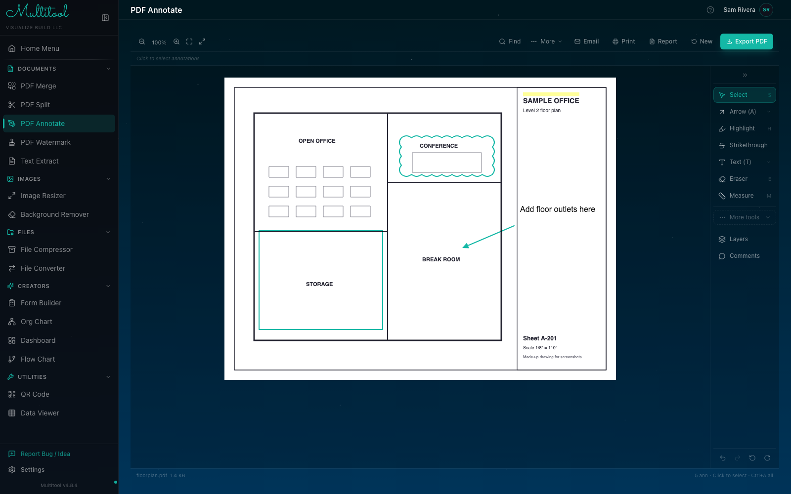

# Multitool

Multitool is a set of 15 browser tools for PDFs, images, files, diagrams and dashboards. The main build is one HTML file that you can put on a file share or open from the desktop. It needs no server and no install.

I started it after my workplace lost its PDF editor licenses. The first version covered viewing and marking up PDFs, and the other tools were added as coworkers asked for them.

- Hosted copy (a lighter build without OCR): https://noahfgarrett.github.io/Multitool/
- Full single-file build: [latest release](https://github.com/noahfgarrett/Multitool/releases/latest)



## Tools

- Documents: PDF merge (plus a grid mode for stitching tiled drawings into one page), split, watermark, annotate, text extraction
- Images: resize, remove a background by color
- Files: compress images and PDFs or bundle them as a ZIP, convert between formats (including HEIC images and CSV, TSV, XLSX and JSON)
- Creators: form builder, org chart, flowchart, dashboard
- Utilities: QR code generator, JSON/CSV viewer

A few of them do more than the name suggests:

- PDF Annotate draws large pages as tiles, renders the visible ones first and keeps a small cache of recently viewed pages. Markups are written into the exported PDF's metadata, so the file can be reopened and edited later. They can also be exported as CSV, and a compare mode shows two PDFs side by side, overlaid or as a diff.
- Text Extract reads the PDF text layer with pdf.js. For scanned pages it runs PaddleOCR (PP-OCRv6 small detection and recognition models on ONNX Runtime Web) and falls back to Tesseract.js if Paddle can't start or finds no text. Table mode rebuilds columns from the page's vertical ruling lines. Results export to CSV, XLSX, DOCX or plain text.
- The dashboard builder imports CSV or Excel files and lays out bar, line, area, pie, scatter, heatmap, treemap and KPI widgets on a grid, with AND/OR filter groups per widget. In Chrome and Edge it can store a file handle in IndexedDB so a saved dashboard reconnects to its source file.
- Form Builder exports fillable PDFs with real form fields (via pdf-lib), flat PDFs or Word documents.
- Flowchart turns a short text outline (`START`, `IF`, `YES`/`NO`, `END`) into a diagram and exports PNG, SVG, JSON or Visio `.vsdx`.

## Builds

The same source produces three builds. `src/utils/viteBuildMode.ts` decides which one.

- `npm run build` writes `dist/Multitool.html`. `vite-plugin-singlefile` inlines every script and stylesheet, and the OCR models and ONNX wasm go in too, so the file is about 125 MB (53 MB gzipped). `scripts/gzip-dist.mjs` writes the `.gz` copy that releases use for in-app updates.
- `npm run build:pwa` writes `dist-pages/`, a normal code-split build of about 8 MB. OCR is swapped for a stub (`src/utils/ocr/pwaRuntime.ts`). This is the version on GitHub Pages.
- `npm run tauri:build` packages a desktop app with Tauri 2 from a code-split build. `.github/workflows/tauri-windows.yml` builds the Windows installer when run manually.

## Network use

Files are processed in the browser and never uploaded. The standalone HTML file asks the GitHub Releases API for a newer version at startup and can download and save the update. The installed PWA and the desktop app skip that check. Tesseract, which only runs when PaddleOCR fails, downloads its worker and language data from a CDN.

## Stack

React 19, TypeScript, Vite 6, Tailwind CSS 3, Zustand, pdf.js, pdf-lib, PaddleOCR.js, Tesseract.js, SheetJS, ExcelJS, docx, Recharts, dnd-kit, react-grid-layout, Tauri 2.

## Run locally

```sh
npm ci
npm run dev        # http://localhost:5173
```

## Tests

```sh
npm run test:unit  # node:test through tsx, for pure modules (tile scheduling, OCR parsing, layout, storage migration)
npm test           # Playwright specs in e2e/, starts Vite on port 5180
```

## Layout

```
src/tools/<tool>/   one folder per tool, registered in src/tools/registry.ts
src/components/     shared UI (layout, modals, file drop zone)
src/utils/          PDF helpers, OCR runtimes, conversion, update check
src-tauri/          desktop shell
e2e/                Playwright specs and fixtures
```
